# Dashboard-Audit · Nicht-Chart-Bereiche

> **Ergebnis: funktionsfähig, aber noch nicht visuell und betrieblich abnahmefähig.** Insbesondere Hell-Theme, mobile Header/Matrix, Datenfrische und kritische Validierungen benötigen Nacharbeit. Keine Reparaturen durchgeführt.

## Stand und Grenzen

- Audit erstellt: **2026-10-09T06:30:41+02:00**. Repository: `C:/Users/zirku/Downloads/testing`.
- Erst `git pull --ff-only`: `b7153cb` → **`b7cabcd3a1eb103eccf02451eb6a8ebf6d612b16`**, `main`. Bestehende unversionierte Dateien beibehalten; kein Stash/Reset/Commit/Push.
- Separate Testinstanz gestartet: **http://127.0.0.1:8057** mit `DASHBOARD_PORT=8057 C:/Python314/python.exe app.py`. Bereits belegten Port 8050 nicht beendet oder ersetzt.
- Laufzeit: Windows, Python **3.14.3**, Chromium **145.0.7632.6**. Beide konfigurierte Demo-Konten lieferten echte Status-GETs: Titan 3, Gold 2 offene Positionen im Snapshot.
- **Chart-System ausdrücklich ausgeschlossen:** keine Chart-Funktionsprüfung, kein Chart-Studio-/Money-Audit, keine Reparatur daran. Vollseitenbilder enthalten den unveränderten Chart nur als Umgebung. Vorhandene Contracttests enthalten vereinzelte Chart-Textasserts; daraus wird keine Chart-Abnahme abgeleitet.
- **Keine echten Handelsaktionen, SL/TP-Änderungen oder Resets.** Alle Browserrequests außer GET/HEAD wurden vor dem Backend abgefangen oder abgebrochen. Drei abgefangene POSTs (ungültige Baseline, Quick-TP, Close) wurden mit ausdrücklich simulierten Antworten beantwortet. Backend-Fehlerfälle liefen isoliert mit Mock-MT5 und Mock-Dateizugriffen.
- Nur neue Dokumentation, Bilder, Evidenz und reproduzierbare Audit-Harnesses im Auditordner geschrieben. Nach dem Pull keine Anwendung/Styles/Handelslogik geändert.
- Screenshots/JSON enthalten Konto-, Ticket- und Finanzdaten: **lokale vertrauliche Dokumentation**, nicht unredigiert veröffentlichen.

## Kurzbilanz

| Prüfung | Verifiziertes Ergebnis |
|---|---|
| Bestehende relevante pytest-Suite | **40 Tests + 10 Subtests bestanden**, 12,52 s; JUnit und Textprotokoll vorhanden |
| Browser-Verhaltensprüfungen | **35/39 bestanden**; 4 bewusst aufgedeckte Fehler, keine Laufzeitausnahme des Harnesses |
| Visuelle Hauptmatrix | **18 Ansichten** = 2 Konten × 3 Themes × 3 Größen (1440×1000, 768×1024, 390×844) |
| Ergänzende Reflow-Proben | Titan: 320 px und 720 px für alle drei Themes. 720 px ist nur 200%-Zoom-Layoutäquivalent, kein vollwertiger Browserzoom-Test |
| Browserfehler | **0 pageerror**, **0 requestfailed** im Hauptlauf; Fehlerzustände gesondert injiziert |
| Accessibility | axe-core 4.10.3 für 6 Nicht-Chart-Desktop-Sichten; Kontrast + Feldnamen + manuelle Fokus-/Escape-Proben |
| Lese-API-Mikrobenchmark | Je 10 Samples für Status/Journal × 2 Konten = 40 serielle GETs; 4 weitere parallele Status-GETs |
| Konsolidierte Befunde | **20**: P1: 11, P2: 8, P3: 1; kein P0-Schaden oder realer Tradefehler provoziert |

**P1** = vor sicherer breiter Nutzung / Freigabe beheben; **P2** = mittlere Verbesserung/Datengenauigkeit; **P3** = Optimierung. axe-Impact wie „critical“ beschreibt die Regel, nicht automatisch einen P0-Vorfall.

## Was bereits funktioniert

- Kontoidentität wird auf dem Backend pro Request gegen Login, Server, Terminalpfad und Verbindung geprüft. Globaler Lock schützt vor Accountwechsel mitten im Request; Tests decken parallele Konten ab.
- Derselbe Account nutzt die verifizierte MT5-Verbindung wieder. Die alte Auditbehauptung „jede Anfrage verbindet neu“ trifft auf diesen Stand nicht mehr zu.
- Geschwindigkeitsfixes vorhanden: vektorisiertes Volumenprofil, kontospezifischer Journal-TTL, lokale kompilierten Tailwind-CSS und lokale Scriptdateien; kein Tailwind Play-CDN im aktuellen Lauf.
- Normale Statusupdates bewahren geänderte SL-Eingaben auch nach Blur; Fokus bleibt erhalten. Der verbleibende Fehler betrifft Strukturänderungen.
- Späte Titan-Antwort überschreibt nach Wechsel nicht Gold. Journalfilter ändern nicht das aktive Handelskonto.
- Expliziter Status-503 leert alte Kontodaten und sperrt Reset; echte GETs erholen sich nach Aufheben der Teststörung.
- Gold zeigt 6 Einstiegskriterien und 3 Momentum-Ausstiegsziele. Baseline- und Reservehinweise sind vorhanden; Resetbeschreibung weist auf reine Anzeigewirkung hin.
- Stone-Deko berücksichtigt in den gesampelten Elementen Reduced Motion. Theme/Kontowahl übersteht Reload.

## Visueller Überblick und Kontraste

### M15-SCHLUSS – der Screenshot-Hinweis ist berechtigt

Der Countdown nutzt `rgb(59,130,246)` für Label und Wert. Gemessene Schrift: Label **11 px**, Zeit **12 px**, beide fett. Dark-Kontrast **4,42:1** auf `#111f3f` – knapp unter 4,5:1. Light **2,98:1** auf `#dee8fc` – klar zu schwach. Stone hat Texturen/Gradienten: axe markiert die Kontrastprüfung als unvollständig; hier kein erfundener exakter Wert. Bilder zeigen dennoch kleine, wenig priorisierte Schrift.

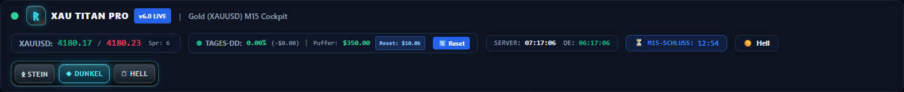
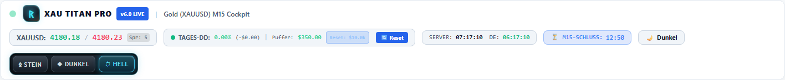
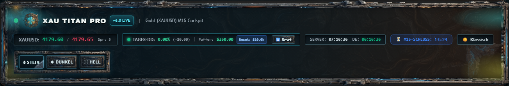

### Messbare kritische Textkontraste

| Element | Theme | Kontrast | Ziel für kleinen Text |
|---|---|---:|---:|
| M15-Label/Zeit | Dark | 4,42:1 | 4,5:1 |
| M15-Label/Zeit | Light | 2,98:1 | 4,5:1 |
| Tages-DD/Puffer | Light | 1,75:1 | 4,5:1 |
| Reset-Tag | Light | 1,32:1 | 4,5:1 |
| Bid | Light | 2,31:1 | 4,5:1 |
| Ask | Light | 3,35:1 | 4,5:1 |
| LIVE-Kontobestätigung | Light | 2,53:1 | 4,5:1 |
| BUY-Badge weiß/grün | Dark | 3,76:1 | 4,5:1 |

Die dargestellten axe-Zahlen gelten für diesen DOM/Snapshot, nicht für alle Zustände. Weiß-auf-Weiß bei Journalpreisen ist zusätzlich im Screenshot und Quellcode nachgewiesen. Stone kann wegen Texturen nicht automatisch als kontrastkonform bezeichnet werden.

## Befundübersicht

| ID | Priorität | Befund | Nachweis |
|---|---|---|---|
| [VIS-01](#vis-01) | P1 | Helles Theme: Preise verschwinden und Risikowerte sind zu blass | Browser + Screenshot + axe-core |
| [VIS-02](#vis-02) | P1 | Mobile Header verliert Countdown und Reset; Matrix wird abgeschnitten | Browser-Geometrie + Screenshots + Scrollprobe |
| [REL-01](#rel-01) | P1 | Hängender Status-GET bleibt LIVE und blockiert Aktualisierung | Injizierter Browser-Netzwerkfehler, keine Backendänderung |
| [REL-02](#rel-02) | P1 | Positionsänderung verwirft auch unbetroffene SL/TP-Entwürfe | Browser-Test, zusätzliche Position nur im Speicher |
| [SAFE-01](#safe-01) | P1 | Ungültige Stops und Reset-Eingaben werden nicht strikt abgewiesen | Intercepted Browser-POST + isolierter Mock-Backend-Test |
| [SAFE-02](#safe-02) | P1 | Reset meldet Erfolg selbst wenn beide Dateischreibungen scheitern | Isolierter Mock-Test, Diskwrites vollständig ersetzt |
| [SAFE-03](#safe-03) | P1 | Manueller Tagesreset läuft nicht automatisch am Folgetag aus | Code + isolierter Tageswechsel-Mock |
| [SAFE-04](#safe-04) | P1 | Historienfehler wird als null Tagesverlust behandelt | Isolierter Mock-Test + Codeanalyse |
| [SEC-01](#sec-01) | P1 | Mutations-APIs ohne Aufruferauthentisierung; Zielprüfung ist keine Berechtigung | Codeanalyse, Mock fremdes Symbol; kein Angriff ausgeführt |
| [A11Y-01](#a11y-01) | P1 | Reset-Modal ohne Fokusführung und Escape; SL/TP-Felder unbeschriftet | Browser-Fokus-/Escape-Test + axe-core + Code |
| [PERF-01](#perf-01) | P1 | Stone-Dekoration überträgt viele Megabyte für kleine Ornamente | Frischer Browserkontext, echte Resource-Timing-Werte |
| [DATA-01](#data-01) | P2 | Journal-Begründungen sind teils fest codiert und widersprechen Trades | Echter GET + Screenshot + Codeanalyse |
| [DATA-02](#data-02) | P2 | Titan-Matrix ist laufende Vorschau, nicht bestätigtes Schlusskerzensignal | Code + isolierter Open-Bar-Mock + echte UI |
| [REL-03](#rel-03) | P2 | Journal-Ausfall zeigt $0,00 statt unbekannt; Startfehler erholt sich nur teilweise | Injizierte Browser-503 Tests |
| [PERF-02](#perf-02) | P2 | Vollständiger Status und Journal-Cache belasten gemeinsame Kontosperre | Echte GET-Latenzproben + Codeanalyse |
| [UX-01](#ux-01) | P2 | Nebeninformationen und Handelsfelder sind sehr klein | Computed styles + Bounding boxes + Screenshots |
| [VIS-03](#vis-03) | P2 | Diagnose-Poll entfernt Stone-Panelklassen | Echter Browser DOM-Readback + Code |
| [OPS-01](#ops-01) | P2 | Start-/Testumgebung nicht eindeutig festgelegt | Echte Interpreter-/pytest-Ausgaben + Manifest-/Workflowprüfung |
| [DATA-03](#data-03) | P2 | Bestätigte Tagesbasis ist kein Heartbeat des EA-Schutzes | Statische Codeanalyse, kein EA-Ausfall provoziert |
| [PERF-03](#perf-03) | P3 | Dekorative Effekte und Journal-Rebuild noch ohne Budget | Codeanalyse; reduzierte Stone-Deko im Browser geprüft |

## Einzelbefunde

<a id="vis-01"></a>
### VIS-01 · Helles Theme: Preise verschwinden und Risikowerte sind zu blass

**P1 · Kontrast / Lesbarkeit** · Nachweis: Browser + Screenshot + axe-core

**Quelle:** `app.py:1029–1038,1366,2014–2023,2400,2479–2484`

**Reproduktion:** Design Hell wählen; Header und Journal betrachten. Im DOM stehen Einstieg/Ausstieg, im Screenshot wirken diese Felder leer.

**Ist:** Weiß auf Weiß bei Journalpreisen und Aufnahmebeginn. Gemessen: Tages-DD/Puffer 1,75:1; Bid 2,31:1; Reset-Tag 1,32:1. axe meldet je Konto 161 betroffene Kontrastknoten im geprüften Desktop-Scope.

**Soll:** Alle Konten- und Risikodaten sind in jedem Theme lesbar; kleiner Text mindestens 4,5:1.

**Empfehlung (noch nicht umgesetzt):** Semantische Farb-Tokens statt festem text-white/text-emerald-400; in Light dunklere Statusfarben. Eingangs-/Ausgangspreise, Zeit und Puffer zuerst korrigieren.

**Abnahme:** axe-Kontrastbefunde für die Nicht-Chart-Bereiche beseitigt; Screenshotvergleich bestätigt sichtbare Journalpreise.


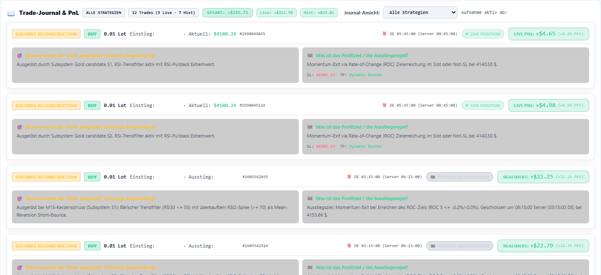

<a id="vis-02"></a>
### VIS-02 · Mobile Header verliert Countdown und Reset; Matrix wird abgeschnitten

**P1 · Responsive** · Nachweis: Browser-Geometrie + Screenshots + Scrollprobe

**Quelle:** `app.py:1085–1091,1300–1333; static/stone-asset-skin.css:918–920`

**Reproduktion:** Titan bei 390 px und 320 px in Dark/Light öffnen; Header und Matrix prüfen. Stone-Matrix nach rechts wischen.

**Ist:** Bei 320 px liegt das rechte Ende des Countdown bei x=394,14 (Dark/Light) bzw. 397,14 (Stone), außerhalb des Viewports. Titan-Matrix bei 390 px: 359,23 px Tabelle in 336 px Container, overflow-x:hidden. In Stone: 530 px Tabelle in 322 px Container; sie ist tatsächlich um 208 px scrollbar, aber ohne klaren Hinweis. Ein sichtbarer Ausschnitt ist keine vollständige Regelübersicht.

**Soll:** Countdown und wichtige Buttons vollständig sichtbar; jede Matrixspalte erreichbar, ohne versteckte Daten.

**Empfehlung (noch nicht umgesetzt):** Headerchips dürfen umbrechen. Mobile Matrix als Regelkarten oder zugänglichen horizontalen Scrollbereich mit Wischhinweis gestalten. Nicht einfach Body-Overflow verstecken.

**Abnahme:** 320/390/768 px und 200%-Reflow: kein Beschnitt wichtiger Daten; Fokus-/Touch-Scroll erreicht alle Matrixwerte.

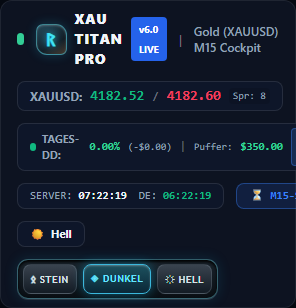

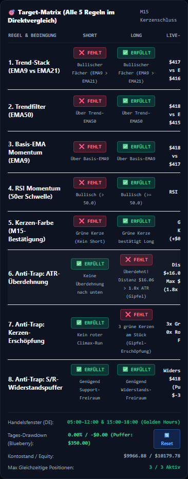

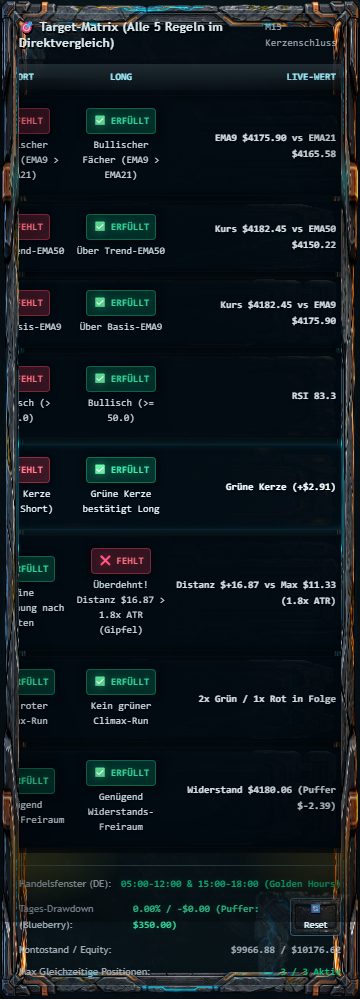

<a id="rel-01"></a>
### REL-01 · Hängender Status-GET bleibt LIVE und blockiert Aktualisierung

**P1 · Stabilität / Aktualität** · Nachweis: Injizierter Browser-Netzwerkfehler, keine Backendänderung

**Quelle:** `app.py:1521–1526,1961–1966,1974–1977,2089–2091,2696`

**Reproduktion:** Nach bestätigtem Gold-Status den Status-fetch als nicht auflösende Promise simulieren; updateStatus aufrufen; 6,5 s warten.

**Ist:** statusBusy bleibt gesetzt; currentData bleibt vorhanden; Label bleibt LIVE · Konto 53090070 bestätigt; Reset bleibt aktiviert. Keine Deadline, kein sichtbarer Datenalter-Wert.

**Soll:** Unfrische Daten nicht als LIVE deklarieren; Handelsaktionen nur bei nachweislich frischem Status.

**Empfehlung (noch nicht umgesetzt):** AbortController mit Deadline, last-success/age und Stale-Zustand, Backoff und Wiederanlauf. Auf Kontoänderung alte Requests wirklich abbrechen; Generation-Prüfung beibehalten.

**Abnahme:** Blackhole/Timeout-Test: binnen definierter Frist STALE/OFFLINE, Aktionen gesperrt, nach Erholung selbstständiger Wiederanlauf.

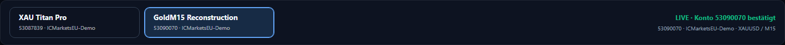

<a id="rel-02"></a>
### REL-02 · Positionsänderung verwirft auch unbetroffene SL/TP-Entwürfe

**P1 · Editierzustand** · Nachweis: Browser-Test, zusätzliche Position nur im Speicher

**Quelle:** `app.py:2192–2200,2210–2250,2264–2269`

**Reproduktion:** Bestehendes SL-Feld auf -37,00 ändern; unveränderte Positionen plus eine nur im Browser erzeugte neue Zeile rendern.

**Ist:** Normale Live-Polls bewahren Fokus und Dirty-Wert korrekt. Sobald sich die Struktur ändert, wird die ganze Liste ersetzt: Wert fiel im Test auf -30,41 zurück, Fokus ging verloren.

**Soll:** Ungespeicherte Änderungen bestehender Tickets bleiben bei neuen/geschlossenen anderen Positionen erhalten.

**Empfehlung (noch nicht umgesetzt):** Ticketbasierte DOM-Updates; Entwurfsspeicher pro Konto/Ticket und sichtbarer Dirty-Zustand. Bei eigenem Ticketverlust klar informieren.

**Abnahme:** Tests für neue Position, Fremdposition geschlossen, Reihenfolge und Teilvolumen; unbetroffene Eingaben/Fokus bleiben erhalten.

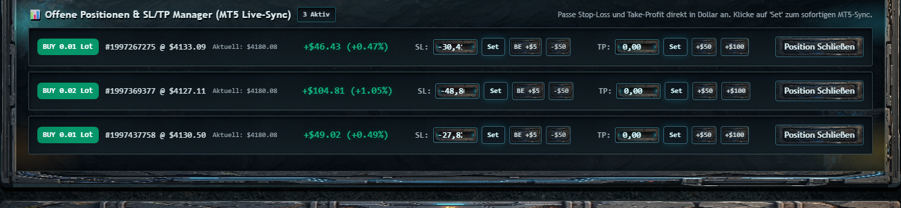

<a id="safe-01"></a>
### SAFE-01 · Ungültige Stops und Reset-Eingaben werden nicht strikt abgewiesen

**P1 · Mutation / Validierung** · Nachweis: Intercepted Browser-POST + isolierter Mock-Backend-Test

**Quelle:** `app.py:44–56,875–891,946–960,2636–2643`

**Reproduktion:** Nur isoliert: ModifyPositionRequest(sl_price=-1) durch Mock-Endpunkt; Reset(action='garbage'); Browser-Baseline -100 bei abgefangenen Writes.

**Ist:** Negativer Stoppreis erzeugte Mock-Auftrag sl=0.0 (Stop entfernen). Ungültige Aktion aktivierte Reset; negative Baseline fiel still auf Balance zurück. Infinity wurde im direkten Modell/Handler akzeptiert. Browser sendet -100 statt den Wert abzulehnen. Kein echter Order- oder Resetversand.

**Soll:** Ungültige Zahlen/Aktionen verursachen 422/verständliche Validierungsfehler; Entfernung eines Stops nur ausdrücklich.

**Empfehlung (noch nicht umgesetzt):** FiniteFloat/Bounds, Enum für action, positive Ticketprüfung, klare Remove-Operation; USD und Preis gegenseitig ausschließen. Schutzpreisvalidierung gegen Tickgröße/Stops-Level vor Versand.

**Abnahme:** Mock-Tests für negative Preise, NaN/Infinity, leere/negative Baseline, falsche Aktion, Konfliktfelder. Bei Fehler nie order_send/save aufrufen.

<a id="safe-02"></a>
### SAFE-02 · Reset meldet Erfolg selbst wenn beide Dateischreibungen scheitern

**P1 · Persistenz** · Nachweis: Isolierter Mock-Test, Diskwrites vollständig ersetzt

**Quelle:** `app.py:62–100,953–957,968–973`

**Reproduktion:** builtins.open mit PermissionError mocken; MT5 vollständig fake; Reset-Handler direkt ausführen.

**Ist:** Beide Schreibzugriffe protokollieren Fehler, API-Ergebnis trotzdem success:true. Writes sind nicht atomar. Konfigurationsloader prüft kein Schema; gültiges JSON falscher Struktur kann später scheitern.

**Soll:** Erfolg erst bei überprüfter Persistenz; Teilfehler offen melden; kein beschädigter JSON-Zustand.

**Empfehlung (noch nicht umgesetzt):** Validiertes Schema, atomarer Ersatz der jeweiligen Datei, klare Strategie für zwei Ziele; bei Schreibfehler kein success:true. Readback und explizite Fehlerzustände.

**Abnahme:** Read-only/mock Tests für Schreibschutz, fehlendes Verzeichnis, beschädigtes JSON, [] statt Objekt, Ausfall zwischen Zielen.

<a id="safe-03"></a>
### SAFE-03 · Manueller Tagesreset läuft nicht automatisch am Folgetag aus

**P1 · Drawdown / Tageswechsel** · Nachweis: Code + isolierter Tageswechsel-Mock

**Quelle:** `app.py:558–580,654–657,963–966`

**Reproduktion:** Mock-Config manual_reset_active=true mit Reset einen Tag vor aktuellem Tick; Status berechnen.

**Ist:** Alte 10000-Baseline bleibt aktiv: bei Balance/Equity 9700 wird 3% DD angezeigt. reset_date wird zwar gespeichert, aber nicht geprüft. Bei Gold unterdrückt manual_active zudem die bestätigte EA-Tagesbasis.

**Soll:** Tagesbezogene manuelle Baseline hat einen expliziten Risikotag und Ablauf; kein stilles Fortschreiben.

**Empfehlung (noch nicht umgesetzt):** Expiry nach Kontorisikotag, dokumentierte Zeitzone, kontrollierter Wechsel zur Auto-/EA-Basis. Anzeige-Reset strikt vom EA-Reset trennen.

**Abnahme:** Mitternacht, Neustart, Sommerzeit und Folgetag als Regression testen; Nutzer sieht wirksamen Baseline-Tag.

<a id="safe-04"></a>
### SAFE-04 · Historienfehler wird als null Tagesverlust behandelt

**P1 · Datenqualität / Risiko** · Nachweis: Isolierter Mock-Test + Codeanalyse

**Quelle:** `app.py:186–187,566–580,582–605`

**Reproduktion:** history_deals_get gibt None statt einer leeren erfolgreichen Liste zurück; Status mit Balance=Equity=9700 berechnen.

**Ist:** Ergebnis: Tagesstart 9700, realized_today=0, DD=0%, Puffer 339,50. Die API unterscheidet fehlgeschlagene Historienabfrage nicht von keinen Deals. Test zeigt die Fallbackwirkung, nicht einen realen Verlustfall.

**Soll:** Unbekannte Historie führt zu unverifiziertem Risiko-/Journalstatus, nicht zu Nullverlust.

**Empfehlung (noch nicht umgesetzt):** None/Fehler getrennt von [] behandeln, MT5-Fehlercode erfassen, validierte letzte Baseline verwenden oder Werte als unbekannt ausgeben.

**Abnahme:** MT5-None, Teilhistorie, Wiederherstellung und realisierte Tagesverluste unter Mocks prüfen.

<a id="sec-01"></a>
### SEC-01 · Mutations-APIs ohne Aufruferauthentisierung; Zielprüfung ist keine Berechtigung

**P1 · API-Sicherheit** · Nachweis: Codeanalyse, Mock fremdes Symbol; kein Angriff ausgeführt

**Quelle:** `app.py:858–860,901–903,936–938,2713; account_gateway.py:92–102,148–154`

**Reproduktion:** Codeprüfung: kein Auth-/Rollen-Dependency an Mutationen; account hat Titan-Default. Isolierter Mock liefert EURUSD-Ticket an close_position.

**Ist:** Handler erzeugte EURUSD-Schließauftrag im Mock, ohne Symbol/Magic-Scope. Konto-/Terminalidentität wird korrekt geprüft, Clientidentität nicht. Serverstart nur Loopback; externe Erreichbarkeit wurde nicht nachgewiesen.

**Soll:** Nur autorisierte Nutzer dürfen explizit gewählte, freigegebene Positionen ändern; kein stiller Titan-Default bei Writes.

**Empfehlung (noch nicht umgesetzt):** Vor Proxy/Tunnel-Zugang Auth, Host-/Origin-Schutz, explizites Pflichtkonto und Positionsberechtigung/Symbol-Magic-Policy. Idempotenz und Audit-Log für kritische Aktionen.

**Abnahme:** Unautorisiert/falscher Host/fehlendes Konto/fremde Strategie schlagen vor order_send fehl; Loopback-Bindung bleibt Default.

<a id="a11y-01"></a>
### A11Y-01 · Reset-Modal ohne Fokusführung und Escape; SL/TP-Felder unbeschriftet

**P1 · Tastatur / Screenreader** · Nachweis: Browser-Fokus-/Escape-Test + axe-core + Code

**Quelle:** `app.py:1382–1440,2228–2239,2597–2625`

**Reproduktion:** Reset öffnen; document.activeElement ansehen; Escape drücken; SL/TP mit axe prüfen.

**Ist:** role und aria-modal fehlen, Fokus bleibt auf dem Resetbutton außerhalb; Escape schließt nicht. Je Titan 6, je Gold 4 SL/TP-Felder ohne zugänglichen Namen. axe am Modal allein fand keine Verletzung – das ersetzt den manuellen Dialogtest nicht.

**Soll:** Dialogrolle, beschriftete Eingaben, initialer Fokus, Fokusfalle, Escape und Rückgabe; Offline-Sperre auch für Tastatur.

**Empfehlung (noch nicht umgesetzt):** dialog bzw. vollständiges ARIA-Dialogmuster; label for/id; sprechender Close-Name. account-content im Offlinezustand inert oder alle relevanten Controls disabled statt nur pointer-events:none.

**Abnahme:** Kompletter Reset-Dialog allein per Tastatur; Fokus nie hinter Modal; Felder mit Konto/Ticket/Einheit vorgelesen.

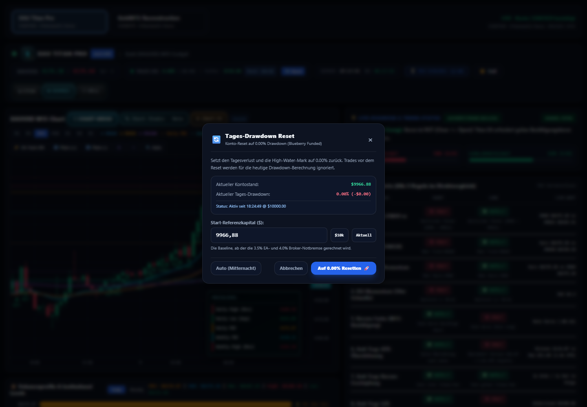

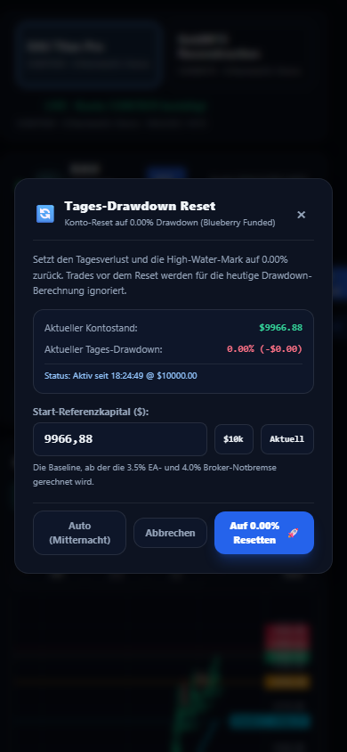

<a id="perf-01"></a>
### PERF-01 · Stone-Dekoration überträgt viele Megabyte für kleine Ornamente

**P1 · Asset-Budget** · Nachweis: Frischer Browserkontext, echte Resource-Timing-Werte

**Quelle:** `static/stone-asset-skin.css:82–87,192–195; supplement-results.json:cold_load.resources`

**Reproduktion:** Frischen Browserkontext ohne Cache öffnen, Standard Stone; Resource Timing auslesen.

**Ist:** 35 stone-assets Ressourcen: 22391976 Byte (21,35 MiB). Konservativ ohne master_dashboard_panel und chart_frame_wide: 33 Ressourcen mit 19311744 Byte (18,42 MiB). Emblem 1186368 Byte für ca. 42×42 CSS-px. Gesamter erfasster Resource-Transfer 21,75 MiB, inklusive Chartressourcen; kein isolierter Nicht-Chart-Ladezeitwert.

**Soll:** Decorative UI darf mobile Ladezeit/RAM nicht dominieren.

**Empfehlung (noch nicht umgesetzt):** Responsive klein exportierte Embleme/Reliefs, vereinfachte SVG/CSS-Rahmen, nicht sichtbare Assets später laden. WebP ist bereits vorhanden; bloßer Formatwechsel löst die übergroßen Dimensionen nicht.

**Abnahme:** Vorgeschlagenes Budget: Nicht-Chart-Dekoration <=3 MiB bei Erstaufruf; optischer Screenshotvergleich und echtes Netzwerkprofil.


<a id="data-01"></a>
### DATA-01 · Journal-Begründungen sind teils fest codiert und widersprechen Trades

**P2 · Journal / Zeit / PnL** · Nachweis: Echter GET + Screenshot + Codeanalyse

**Quelle:** `app.py:184–204,220–221,245–249,265–268,1366,2392–2396`

**Reproduktion:** Historische Gold-BUY-Karten und Titan-Live-Karten vergleichen; Preise/Zeit/Begründung lesen.

**Ist:** Gold BUY wird als Mean-Reversion Short-Bounce erklärt; Titan-Trades teilen fixe Preis-/RSI-/SL-Begründung. UI sagt Heute 20:00, Backend hat festen Cutoff 2026-10-08. Journal nutzt lokalen fromtimestamp plus pauschal -3h, Header lokale Zeit: im sichtbaren Snapshot Server-DE Header 1h, Journal 3h. Summen verwenden profit_usd statt vorhandenes net_profit_usd; Manager zählt Swap, Live-Journal nicht. Historische Entry-/Exit-Verknüpfung filtert nicht zwingend Entry-In oder Magic/Symbol.

**Soll:** Begründungen nur aus belegten Ereignisdaten; konsistente Zeitzone, Datum, Strategy-Scope und Netto-PnL.

**Empfehlung (noch nicht umgesetzt):** Unbekannte Gründe als unbekannt kennzeichnen; echte EA-Ereignisse speichern, symbol/magic/position_id filtern, Teilabschlüsse/Kosten aggregieren. UTC plus explizite Europe/Berlin-Darstellung; Snapshot-Alter je Journalquelle.

**Abnahme:** Long/Short, S3, ältere Entry, Einstiegskommission, Swap, Teilclose und Sommerzeitfixtures; Header-/Journalzeit stimmen für denselben Zeitstempel.

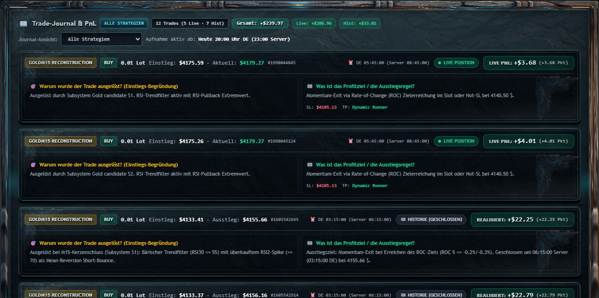

<a id="data-02"></a>
### DATA-02 · Titan-Matrix ist laufende Vorschau, nicht bestätigtes Schlusskerzensignal

**P2 · Signalstatus / Beschriftung** · Nachweis: Code + isolierter Open-Bar-Mock + echte UI

**Quelle:** `app.py:302–310,347–362,1589–1591,1978–1979`

**Reproduktion:** Nur laufende letzte Kerze im Mock ändern, abgeschlossene Kerzen unverändert lassen.

**Ist:** Readiness änderte sich 87% auf 25%. Dashboard verwendet laufende Kerze und rollierenden RSI, Kommentar behauptet 1:1 EA-Schlusslogik. Titel zählt 5 Regeln, obwohl 8 Zeilen/Readiness-Nenner vorhanden sind. HANDEL OFFEN basiert bei Titan nur auf server_time.hour !=0, während daneben Golden Hours stehen.

**Soll:** Vorschau, bestätigte Schlusskriterien und tatsächliche EA-Freigabe klar getrennt; Regelzahl dynamisch.

**Empfehlung (noch nicht umgesetzt):** Aktuelle Vorschau ausdrücklich labeln; bestätigte Shift-1-Werte separat. EA-Indikatorreferenzen und Freigabegates prüfen; keine Ausführungsfreigabe nur aus Uhrzeit ableiten.

**Abnahme:** Titan-Open-Bar-Invarianz für bestätigte Signale; Referenz-RSI; Readiness immer konsistent zur Matrix.

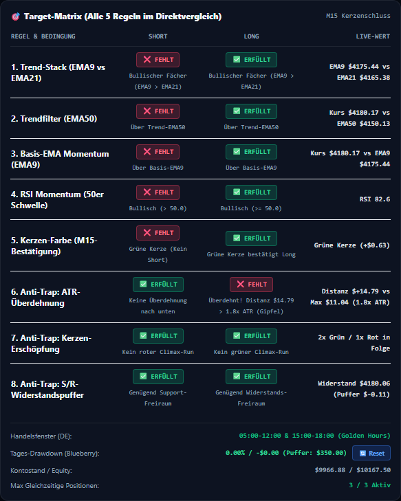

<a id="rel-03"></a>
### REL-03 · Journal-Ausfall zeigt $0,00 statt unbekannt; Startfehler erholt sich nur teilweise

**P2 · Fehlerzustände** · Nachweis: Injizierte Browser-503 Tests

**Quelle:** `app.py:2291–2329,2369–2385,2685–2698`

**Reproduktion:** Beide Journalquellen auf 503 setzen. Separat nur erste /api/accounts-Antwort 503, danach Netz wiederherstellen.

**Ist:** Journal warnt korrekt, zeigt daneben dennoch 0 Aufgezeichnet / PnL: $0.00. Nach anfänglichem Kontolistenfehler holen Statusintervalle Titan-Daten und zeigen LIVE, accounts bleibt nach 7 s leer; Kontowechsel/Journalinitialisierung bleiben unvollständig. Kein kompletter Datenstart-Blackout, sondern partielle Erholung.

**Soll:** Unbekannte Summen als —; Kontoliste/Journale/Wechsel erholen sich vollständig.

**Empfehlung (noch nicht umgesetzt):** Last-known-good je Quelle plus Stale-Kennzeichnung, unvollständige Summen nicht als Gesamt-PnL präsentieren. Bootstrap wiederholen und Zustände pro Feature trennen.

**Abnahme:** Start-/Teilausfall-/Totalausfalltests mit Erholung ohne Reload; Warnung plus — statt Nullsummen.

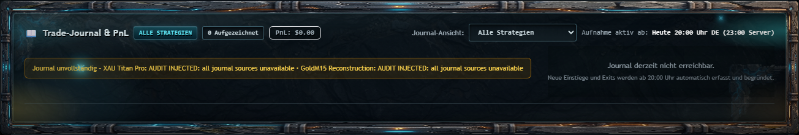

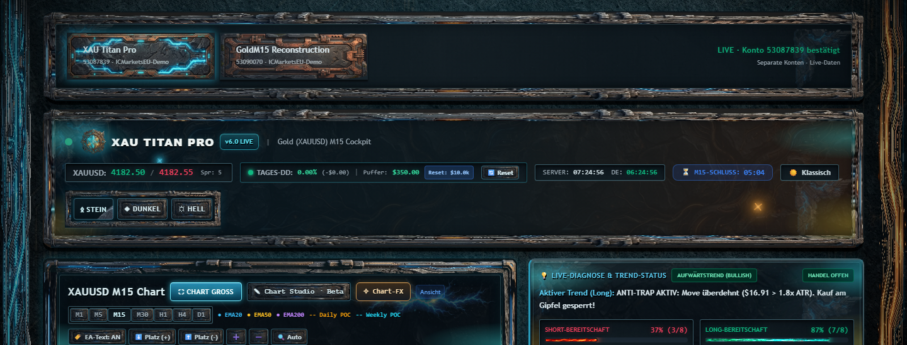

<a id="perf-02"></a>
### PERF-02 · Vollständiger Status und Journal-Cache belasten gemeinsame Kontosperre

**P2 · Backend / Polling** · Nachweis: Echte GET-Latenzproben + Codeanalyse

**Quelle:** `account_gateway.py:116–143; app.py:288–331,644–676,2696–2698`

**Reproduktion:** Je Konto 10 Status-/Journal-GETs seriell, dann 4 Status-GETs parallel; keine Candles im Benchmark.

**Ist:** Statusmedian Titan 82,65 ms, Gold 166,99 ms; parallele vier Requests 72,68–577,38 ms. Vollständige Marktdaten/Indikatoren bleiben pro Status unter einem globalen Lock; Gold liest 5000 Bars. Status liefert Journal und kompletten cache obwohl Frontend Journal separat lädt. Lock schützt Konten und darf nicht unbedacht entfernt werden.

**Soll:** Schnelle frische Snapshots; teure Analysen nur bei relevanten Änderungen; kein unnötiger kontenübergreifender Payload.

**Empfehlung (noch nicht umgesetzt):** Light-Status separat, account-scoped Snapshot/TTL, barbasierte Berechnungscaches, Journal aus Status entkoppeln. Dedicated Workers pro Terminal nur mit strengen Isolationstests. Backgroundtabs drosseln; kein unsicheres Entfernen des MT5-Locks.

**Abnahme:** Vorgeschlagen: Status-p95 <200 ms im repräsentativen Betrieb; gesonderte Messung bei Kontowechsel; identische Daten/Risk-Gates unter Paralleltests.

<a id="ux-01"></a>
### UX-01 · Nebeninformationen und Handelsfelder sind sehr klein

**P2 · Schrift / Touch** · Nachweis: Computed styles + Bounding boxes + Screenshots

**Quelle:** `app.py:2109–2119,2177–2181,2228–2246`

**Reproduktion:** Matrixbedingungen, Spread und Positionsinputs bei Originalgröße/Desktop und 390 px betrachten.

**Ist:** Countdownlabel 11 px, Wert 12 px; Matrixbedingungen 9 px, Live-Werte 10 px. Je Titan-Desktop 10, Gold 8 Nicht-Chart-Controls haben eine Dimension unter 24 px; mobile 8/6. Anzahl ist Geometrieindikator, keine pauschale WCAG-Target-Failure (Abstands-/Ausnahmeregeln nicht geprüft). SL-Felder sind schmal; Theme-Texturen konkurrieren mit Ziffern.

**Soll:** Schnelles fehlerarmes Lesen/Bedienen ohne Zoom, vor allem bei finanziellen Aktionen.

**Empfehlung (noch nicht umgesetzt):** Sekundärtext mindestens 12–14 px als Designziel, wichtige Werte 14–16 px; Zahleneingaben breiter; Touch-Controls möglichst 44 px. SL/TP als Ziel-P/L in USD erklären, TP=0 als Kein fixer TP markieren, Schnellaktionen Wirkung beschriften.

**Abnahme:** Manueller Originalgrößen-/Touch-Review, keine abgeschnittenen Zahleneingaben; klare Einheiten und Set-Wirkung.


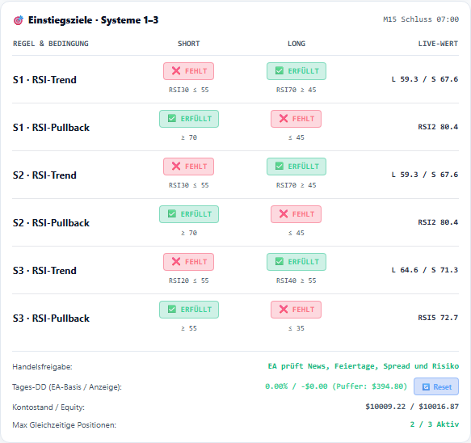

<a id="vis-03"></a>
### VIS-03 · Diagnose-Poll entfernt Stone-Panelklassen

**P2 · Theme-Konsistenz** · Nachweis: Echter Browser DOM-Readback + Code

**Quelle:** `static/stone-cockpit.js:116–130; app.py:2060–2063`

**Reproduktion:** Stone wählen, Status erfolgreich laden, diagnose-card.className lesen.

**Ist:** Klassen nur glass-card rounded-xl p-3.5 border-l-4 border-l-emerald-500; stone-asset-panel/stone-asset-panel--diagnostic wurden durch komplettes className-Ersetzen entfernt.

**Soll:** State-/Trendänderung verändert nur zuständige Zustandsklassen, nicht Theme-Struktur.

**Empfehlung (noch nicht umgesetzt):** classList.toggle für Trendfarben, Theme-Klassen bewahren; auch andere dynamische Badge-/Card-Updates prüfen.

**Abnahme:** Theme-Klassen nach zehn Updates und Accountwechsel unverändert; Golden Screenshot für Diagnosekarte.

<a id="ops-01"></a>
### OPS-01 · Start-/Testumgebung nicht eindeutig festgelegt

**P2 · Reproduzierbarkeit / CI** · Nachweis: Echte Interpreter-/pytest-Ausgaben + Manifest-/Workflowprüfung

**Quelle:** `README.md:54–62; DASHBOARD_ACCOUNTS.md:19–21; .github/workflows/audit-fixes-ci.yml:4–10,23–41`

**Reproduktion:** README python-Befehl in beliebiger Umgebung vs. explizit C:/Python314/python.exe ausführen; Testsammlung vergleichen.

**Ist:** Früherer unspezifischer python -m pytest endete mit 19 Collection-Fehlern (falsche Umgebung/Rootscripts). Kontrollierter relevanter tests/-Scope mit Python314 bestanden. Kein Dependency-Lock/pyproject/pytest-Testpfad-Manifest im Root; lokale absolute Gold-Preset-Pfade. CI hat PR-main-Trigger, nicht generischen push-main; Doku zählt noch 20/18 alte Tests.

**Soll:** Ein reproduzierbarer Install-/Start-/Testweg; Forschungsskripte nicht automatisch live ausführen.

**Empfehlung (noch nicht umgesetzt):** Venv + versionierte Dependencies, pytest testpaths=tests, Brokerfreie Fixtures, GOLDM15_PRESET dokumentieren. Nicht-Chart Visual/A11y/Error-Recovery-Gates auf PRs/main, Doku aus CI-Testzahlen aktualisieren.

**Abnahme:** Frische Windows-Installation startet reproduzierbar; Testlauf greift nie echte Orders/Resetfiles an.

<a id="data-03"></a>
### DATA-03 · Bestätigte Tagesbasis ist kein Heartbeat des EA-Schutzes

**P2 · Guard / Frische** · Nachweis: Statische Codeanalyse, kein EA-Ausfall provoziert

**Quelle:** `goldm15_dashboard.py:97–117; app.py:649–658`

**Reproduktion:** Codeprüfung: gültige Same-Day-Datei bleibt gültig ohne Alter-/Heartbeat-Prüfung.

**Ist:** baseline_verified prüft Version/Tag/Werte, nicht Frische oder laufenden EA. Persistierte Lockwerte können nach EA-Stopp veraltet sein. Live-MT5-Verbindung bestätigt keinen aktiven EA.

**Soll:** Baselinevalidität und aktueller EA-Schutz/Heartbeat getrennt benennen; keine ungeprüfte Handelsfreigabe.

**Empfehlung (noch nicht umgesetzt):** Timestamp/Heartbeat und Konsistenzquellen hinzufügen; stale Schutzstatus explizit unbekannt anzeigen. Hinweis auf Baseline statt Vollfreigabe behalten.

**Abnahme:** EA-stopped/Same-Day-old/inkonsistente Statusquellen unter Fixtures abdecken; kein echter Stop/Trade nötig.

<a id="perf-03"></a>
### PERF-03 · Dekorative Effekte und Journal-Rebuild noch ohne Budget

**P3 · Animation / DOM** · Nachweis: Codeanalyse; reduzierte Stone-Deko im Browser geprüft

**Quelle:** `static/stone-cockpit.js:136–168; static/stone-asset-skin.css:582–645; app.py:2441–2531`

**Reproduktion:** CSS-Animationen und Journal-Rebuild bei Refresh prüfen; reduced-motion aktivieren.

**Ist:** Daueranimationen/Filter und ganzer Journal-innerHTML-Rebuild bleiben. Sampled Stone-Deko respektiert reduced-motion, Dark/Light pulse/ping nicht überall abgesichert. Keine isolierte Nicht-Chart-FPS/CPU/GPU-Messung; ganze Seite enthält Chart und darf nicht diesem Scope zugerechnet werden.

**Soll:** Deko verursacht keinen Leerlauf-/Akkubudget-Ausreißer; keine unnötigen DOM-Ersetzungen.

**Empfehlung (noch nicht umgesetzt):** Off/Low/Full-Deko-Modus, außerhalb Viewport/hinter Tab pausieren; reduced-motion auf alle Themes. Journal diffen, Begründungen einklappbar. Erst danach Profiler-Vergleich.

**Abnahme:** Vorgeschlagenes Frame-Budget <16,7 ms auf Zielgerät; nachprüfbare Trace-Messung getrennt vom Chartteam.

## Performance: gemessen, nicht geschätzt

### Lokale GET-Latenzen

10 Samples pro Zelle, seriell, kein Timeout/HTTP-Fehler. Uvicorn auf demselben Rechner; bereits laufende andere Dashboardinstanz und Brokerlast sind nicht kontrolliert. Kein isolierter CPU-Benchmark, keine SLA-Abnahme, keine Aussage über Internet-/VPS-Leistung. Statusantworten enthalten derzeit Journalcaches. Chart-/Candles-Endpunkte nicht im Benchmark.

| Konto | Endpoint | Min ms | Median ms | Max ms | Payload Byte |
|---|---|---:|---:|---:|---:|
| titan | status | 70.30 | 82.65 | 160.63 | 17973–18022 |
| titan | journal_summary | 25.26 | 40.96 | 55.41 | 11055–11055 |
| goldm15 | status | 151.84 | 166.99 | 282.56 | 21412–21412 |
| goldm15 | journal_summary | 35.55 | 39.16 | 49.52 | 13635–13635 |

Vier parallele Statusrequests: 72.68 ms (titan), 290.91 ms (goldm15), 577.38 ms (titan), 511.44 ms (goldm15). Das passt zur gemeinsamen MT5-Sperre, belegt aber allein nicht deren isolierten Anteil.

### Erstlade- und Assetmessung

- Frischer Chromiumkontext, Standard Stone: **48 Resource-Einträge**, **22.801.806 Byte Transfer** (21,75 MiB). HTML-Dokument ist nicht in dieser Resource-Summe enthalten. Enthält Chart-JS/-APIs und geteilte Rahmen; kein isolierter Nicht-Chart-Seitenwert.
- Stone-Assets: **35 Requests, 22.391.976 Body-Byte** (21,35 MiB). Konservative Teilmenge ohne `11_master_dashboard_panel` und `12_chart_frame_wide`: **33 Requests, 19.311.744 Byte** (18,42 MiB). Geteilte Assets bleiben in dieser Teilmenge möglich.
- Größtes Asset 2.025.248 Byte; Emblem 1.186.368 Byte. WebP-Konvertierung schon vorhanden. Dimensionen/Mehrfachrahmen sind der nächste Hebel.
- Dokument `DOMContentLoaded` **92,3 ms**, `loadEventEnd` **488,3 ms**. Gesamte Harness-Wartezeit bis networkidle/Account bestätigt **2310,89 ms**, enthält künstliche networkidle-Wartezeit. **Nicht** als Nutzer-Ladezeit oder Nicht-Chart-Speedup verkaufen.
- Gelesene Uvicorn-Header: kein `Content-Encoding` bei HTML/CSS/Status; CSS bietet ETag/Last-Modified. Reverse-Proxy-Kompression gesondert prüfen; WebP komprimiert ohnehin.
- Ganze Seiten enthalten Chart-Rendering: gesammelte Long-Task-Daten bleiben Rohdaten ohne Nicht-Chart-FPS/CPU-Zuordnung. Keine CPU-, RAM-, GPU- oder Akkuprozentwerte erfunden.

### Priorisierte Optimierungsreihenfolge

1. **Korrektheit/Frische vor mehr Tempo:** Timeouts, Stale-Alter, sichere Persistenz, Validierung und Baseline-Tagesgrenzen.
2. **Lesbarkeit:** Theme-Tokens, M15-Countdown, alle White-on-white-Stellen, mobile Header/Matrix. Datenflächen ruhig halten, Stone nur als Rahmen.
3. **Weniger Arbeit pro Poll:** Light-Status ohne Journale/Cross-Cache, Indikatoren/Snapshots barbasiert cachen. Kontoisolation nicht für Geschwindigkeit opfern.
4. **Weniger Transfer:** kleine Embleme/Texturen, responsive Größen, offscreen Deko verzögert laden; Nicht-Chart-Deko-Budget ≤3 MiB als Ziel.
5. **Weniger Renderarbeit:** Ticket-/Journal-Deltas, Deko nur sichtbar/aktiv, Reduced Motion für alle Themes; Profiling vor/nach Änderung.

## Testmatrix und Rohbelege

### 18 visuelle Hauptsichten

| Ansicht | Viewport | Kontrastknoten (axe) | Unbenannte SL/TP-Felder | Bild |
|---|---|---:|---:|---|
| titan-stone-desktop | 1440×1000 | unvollständig (Texturen) | 6 | [PNG](screenshots/titan-stone-desktop.png) |
| titan-stone-tablet | 768×1024 | nicht separat automatisiert | siehe Desktop | [PNG](screenshots/titan-stone-tablet.png) |
| titan-stone-mobile | 390×844 | nicht separat automatisiert | siehe Desktop | [PNG](screenshots/titan-stone-mobile.png) |
| titan-dark-desktop | 1440×1000 | 15 | 6 | [PNG](screenshots/titan-dark-desktop.png) |
| titan-dark-tablet | 768×1024 | nicht separat automatisiert | siehe Desktop | [PNG](screenshots/titan-dark-tablet.png) |
| titan-dark-mobile | 390×844 | nicht separat automatisiert | siehe Desktop | [PNG](screenshots/titan-dark-mobile.png) |
| titan-light-desktop | 1440×1000 | 161 | 6 | [PNG](screenshots/titan-light-desktop.png) |
| titan-light-tablet | 768×1024 | nicht separat automatisiert | siehe Desktop | [PNG](screenshots/titan-light-tablet.png) |
| titan-light-mobile | 390×844 | nicht separat automatisiert | siehe Desktop | [PNG](screenshots/titan-light-mobile.png) |
| goldm15-stone-desktop | 1440×1000 | unvollständig (Texturen) | 4 | [PNG](screenshots/goldm15-stone-desktop.png) |
| goldm15-stone-tablet | 768×1024 | nicht separat automatisiert | siehe Desktop | [PNG](screenshots/goldm15-stone-tablet.png) |
| goldm15-stone-mobile | 390×844 | nicht separat automatisiert | siehe Desktop | [PNG](screenshots/goldm15-stone-mobile.png) |
| goldm15-dark-desktop | 1440×1000 | 14 | 4 | [PNG](screenshots/goldm15-dark-desktop.png) |
| goldm15-dark-tablet | 768×1024 | nicht separat automatisiert | siehe Desktop | [PNG](screenshots/goldm15-dark-tablet.png) |
| goldm15-dark-mobile | 390×844 | nicht separat automatisiert | siehe Desktop | [PNG](screenshots/goldm15-dark-mobile.png) |
| goldm15-light-desktop | 1440×1000 | 161 | 4 | [PNG](screenshots/goldm15-light-desktop.png) |
| goldm15-light-tablet | 768×1024 | nicht separat automatisiert | siehe Desktop | [PNG](screenshots/goldm15-light-tablet.png) |
| goldm15-light-mobile | 390×844 | nicht separat automatisiert | siehe Desktop | [PNG](screenshots/goldm15-light-mobile.png) |

axe zählt betroffene DOM-Knoten, nicht eindeutige Produktbugs. Keine Summierung desselben Fehlers über Themes/Konten. Mobile zusätzlich manuell/Geometrie geprüft.

### 39 Browser-Verhaltenschecks

| Nr. | Prüfung | Ergebnis |
|---:|---|---|
| 1 | Live Titan GET confirmed | PASS |
| 2 | titan identity confirmed | PASS |
| 3 | titan/stone selected | PASS |
| 4 | titan/dark selected | PASS |
| 5 | titan/light selected | PASS |
| 6 | goldm15 identity confirmed | PASS |
| 7 | goldm15/stone selected | PASS |
| 8 | goldm15/dark selected | PASS |
| 9 | goldm15/light selected | PASS |
| 10 | Titan matrix dynamic count | PASS |
| 11 | Titan gold details hidden | PASS |
| 12 | Dirty SL preserved after live status refresh | PASS |
| 13 | Dirty SL focus preserved | PASS |
| 14 | Dirty SL preserved after blur and refresh | PASS |
| 15 | Existing edit preserved when position list changes (in-memory only) | **FAIL** – Ist -30.41 / Soll -37.00 |
| 16 | Journal titan does not switch trading account | PASS |
| 17 | Journal titan entries scoped | PASS |
| 18 | Journal goldm15 does not switch trading account | PASS |
| 19 | Journal goldm15 entries scoped | PASS |
| 20 | Journal all does not switch trading account | PASS |
| 21 | Reset modal opens | PASS |
| 22 | Reset modal closes with Escape | **FAIL** – Ist False / Soll True |
| 23 | Negative reset prevented by UI (intercepted, no write) | **FAIL** – Ist 1 / Soll 0 |
| 24 | Position action routing account=titan (intercepted) | PASS |
| 25 | Late account response exercised | PASS |
| 26 | Late Titan response cannot overwrite Gold | PASS |
| 27 | Gold six rules | PASS |
| 28 | Gold three exit goals | PASS |
| 29 | 503 clears current account data | PASS |
| 30 | 503 disables reset | PASS |
| 31 | 503 clears matrix | PASS |
| 32 | 503 clears positions | PASS |
| 33 | Live recovery from injected 503 | PASS |
| 34 | Partial journal failure visible | PASS |
| 35 | Hung status ceases to claim LIVE after 6.5s | **FAIL** – Ist False / Soll True |
| 36 | Selected account survives reload | PASS |
| 37 | Selected theme survives reload | PASS |
| 38 | Reduced motion disables sampled decoration | PASS |
| 39 | No browser pageerror observed (whole page, not chart diagnosis) | PASS |

### Zusätzliche Fehler-/Sicherheitsproben

- **Live:** Accountwechsel, verspätete Antworten, Journalfilter, Reloadpersistenz, Fokus/Dirty-Polling, status/account-GETs, unbekannter Account → 400, unbekannter Pfad → 404.
- **Browserinjiziert:** Status-503 mit Recovery; Journal-Teil-/Totalausfall; hängender Fetch; Kontolisten-Bootstrap-503; leere Positionsliste; künstliche zusätzliche Position. Kein MT5-Terminal gestoppt.
- **Backendmock:** negative Stoppreise, ungültige Aktion/negative/Infinity-Baseline, PermissionError bei Persistenz, anderer Symbolticket, Historie=None, alter Baseline-Tag und geänderte laufende Titan-Kerze. Direkte Modell/Handlerproben sind keine Behauptung identischer HTTP-Serialisierung von Infinity.
- **Kein destruktiver Live-Test:** echte Orderausführung/SLTP/Reset, EAs starten/stoppen, Broker-SL-/Fill-Verhalten, Tageswechsel an echtem Konto, Crash/Restart während echter Writes.

### Reproduzieren (nur mit unverändertem Auditstand)

```bash
# Separates Terminal im Repository; Port 8050 nicht übernehmen
DASHBOARD_PORT=8057 C:/Python314/python.exe app.py

# Relevante brokerisolierte Suite (kein root-level pytest über Forschungsskripte)
C:/Python314/python.exe -m pytest tests/test_multi_account.py tests/test_performance_regressions.py tests/test_stone_theme_contract.py tests/test_stone_celebrations_contract.py tests/test_journal_multi_strategy_contract.py -v

# Audit-Harnesses überschreiben nur ihre Evidenz im Auditordner
C:/Python314/python.exe docs/audits/2026-10-09-dashboard-live/run_audit.py
PYTHONPATH=. C:/Python314/python.exe docs/audits/2026-10-09-dashboard-live/run_supplement.py
PYTHONPATH=. C:/Python314/python.exe docs/audits/2026-10-09-dashboard-live/run_reliability.py
```

Voraussetzungen: Python314 mit vorhandenen numpy/pandas/MetaTrader5/FastAPI/httpx/pytest/Playwright, Chromium und lokaler axe.min.js. Echte GET-Screenshots benötigen die bereits angemeldeten konfigurierte Demo-Terminals. Keine Login-/Terminal-Autostart-Automatik hinzugefügt.

### Artefakte

- `report.html`: lesbarer Bildreport mit Verweisen; `report.pdf`: druckbare Fassung mit eingebetteten Bildern.
- `README.md`: dieselbe Dokumentation als Markdown; `findings.json` und `findings.csv`: priorisierbare Befunde.
- `browser-results.json`: alle 18 Ansichten/axe/39 Checks/GET-Messungen; `supplement-results.json`: Cold-Load, Reflow, erste Mockproben.
- `reliability-results.json`: weitere reproduzierte Fehler; `live-status-*.json`: echte GET-Snapshots (vertraulich).
- `pytest.txt`, `pytest.xml`: reale Testausgaben; `audit-manifest.json`: Commit/Zeit/Hashes. `verification.json`: Abschlusskontrolle der Artefakte.
- `screenshots/`: Originalbilder und eindeutig benannte Nahaufnahmen; kein erfundenes Vorher/Nachher.

## Noch offene Abnahmen / keine Vollständigkeitsbehauptung

- Nur Chromium/Windows automatisiert. Firefox/WebKit/Safari, reale Android-/iOS-Geräte, echte Touch-/Screenreaderprüfung und Browserzoom offen.
- Kein Chart-Audit, kein EA-Profitabilitäts-/Strategiebacktest und keine Aussage, dass die Strategie sicher/profitabel ist.
- Kein stundenlanger Soak-/Lasttest; API-Messungen sind 10er-Stichproben. Kontolock-Anteil, Speicher-/GPU-/Akkukosten benötigen getrennte Profiler-Messung.
- Kein öffentlicher Sicherheitsangriff/Proxy-Tunnel geprüft. Loopback-Dashboard ist nicht automatisch für externe Nutzung abgesichert.
- Kein Golden-Screenshot-Diff gegen historischen Stand: geprüft wurde der gezogene aktuelle Stand. Alte statische Auditbefunde wurden nicht ungeprüft wiederholt.
- Bei Paralleländerungen nach dem gezogenen Commit muss vor Umsetzung erneut abgeglichen werden. Alle Empfehlungen sind **noch nicht umgesetzt**.

## Referenzen

- WCAG Kontrast: https://www.w3.org/WAI/WCAG22/Understanding/contrast-minimum.html
- Dialog-/Fokusmuster: https://www.w3.org/WAI/ARIA/apg/patterns/dialog-modal/
- Fetch-Abbruch: https://developer.mozilla.org/en-US/docs/Web/API/AbortController
- Größenbudget/Responsive Bilder: https://web.dev/learn/images/
- Rohdaten-Axe: https://github.com/dequelabs/axe-core (lokal verwendete Version 4.10.3).
